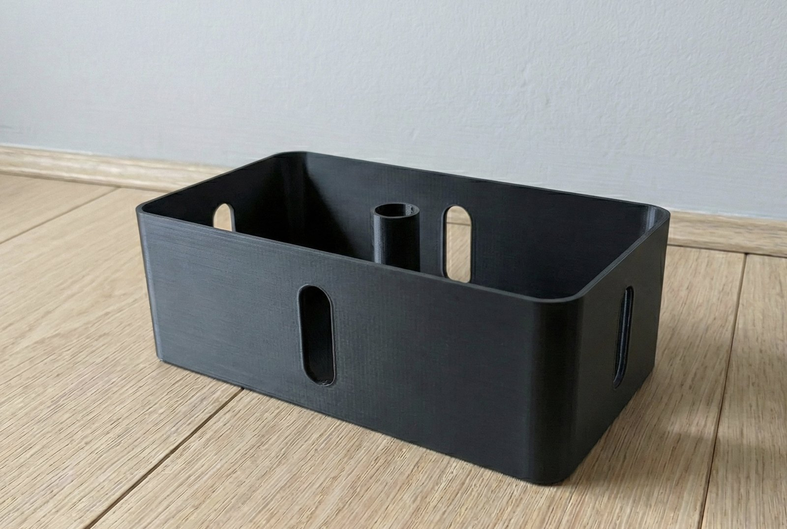
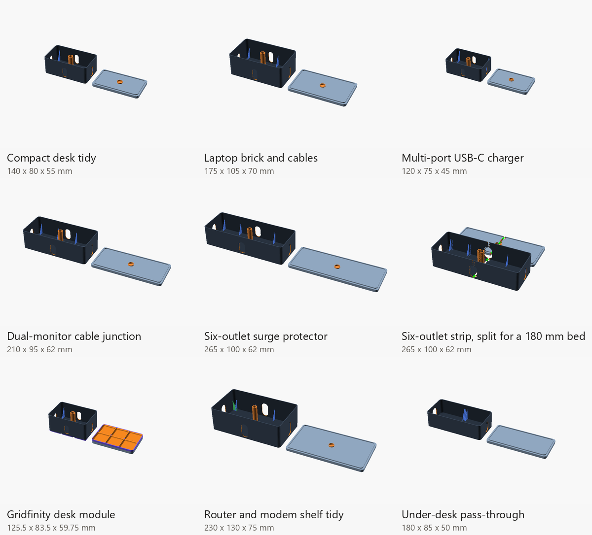
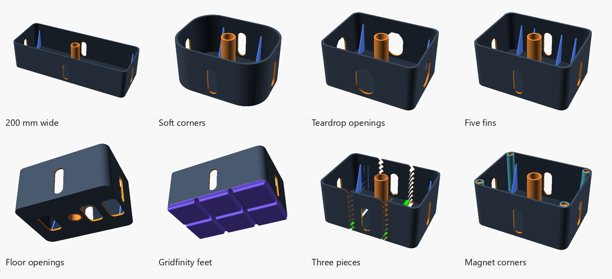

# Ultimate Cable Box

A cable box you size to your own gear, instead of buying one and hoping it
fits. You set the dimensions, the wall openings and the extras, and the model
builds the part.

The model is one OpenSCAD file, `cable-box-parametric.scad`. These pages stay
close to that file, so the behaviour described here is the behaviour the model
produces.

## Get a box

Start here if you own a printer and want a part today.

- [Preset library](../library/): nine ready configurations, each sized for
  something you already own. Every entry carries an orbitable 3D view, the
  parameters behind it, and STL, GLB and `config.json` downloads.
- [Printing guide](PRINTING.md): the baseline settings, which face lands on
  the bed, and the small fit test box to print before a full one.

*The nine presets, drawn at one scale, so the smallest charger box and the
six-outlet strip compare directly. The
[preset library](../library/) also draws each footprint from above against
your printer's bed.*

## Change a box

Start here when a preset is close but not quite right.

- [Workflows](WORKFLOWS.md): install BOSL2, open the Customizer, then tune one
  group of parameters at a time.
- [Options guide](OPTIONS_GUIDE.md): every option rendered from the model, so
  you can see what each one does before you set it.
- [FAQ](FAQ.md): the questions that come up most often, answered with the
  parameter names and the numbers.

*Eight variations on the default box, each a small change from it. Each
view is framed to fit, so the sizes do not compare. The
[options guide](OPTIONS_GUIDE.md) shows every option this way.*

## Reference

These pages describe the model itself. Reach for them when a parameter or an
assertion needs explaining.

- [Parameter reference](PARAMETER_REFERENCE.md): every parameter, section by
  section
- [Parameter interactions](PARAMETER_INTERACTIONS.md): the pairs of parameters
  that constrain each other
- [Validation rules](VALIDATION_RULES.md): each assertion, what trips it, and
  how to resolve it
- [Module reference](MODULE_REFERENCE.md): the geometry modules and what each
  one builds
- [SCAD architecture](SCAD_ARCHITECTURE.md): how a parameter set becomes
  geometry
- [Docs index](DOCS_INDEX.md): every file in the repository, with its purpose
- [Release checklist](RELEASE.md): what a version number promises, and the
  steps that keep that promise

## Scope notes

This set describes the primary model at the repository root. Gridfinity
interfaces, snap-fit seam clips and the preset library are part of that model
and are documented here.

Most of the model is verified by a geometry regression suite rather than by
printing. The
[print validation status](PRINTING.md#print-validation-status) table says
which features have been printed on a real machine, and on which printer.
Treat anything marked "rendered only" as untested in filament.

Contributors should start from
[`CONTRIBUTING.md`](https://github.com/prisant-labs/3d-cable-box-parametric-openscad/blob/main/CONTRIBUTING.md),
which covers building this site locally.
